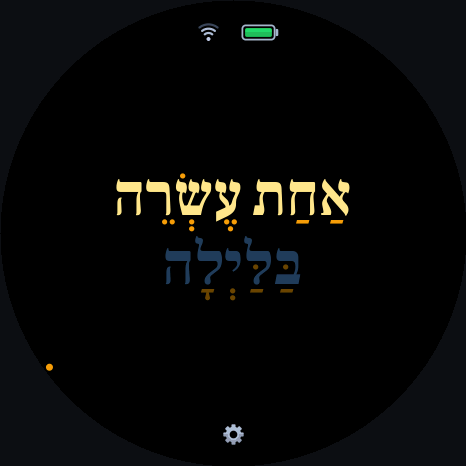

# ws-shaon-millim — שְׁעוֹן מִלִּים (Hebrew Word Clock)

[](README.md)
[](https://www.waveshare.com/esp32-s3-touch-amoled-1.75c.htm)
[-E7352C.svg)](https://www.espressif.com/en/products/socs/esp32-s3)
[](https://docs.espressif.com/projects/esp-idf/en/v5.5.6/esp32s3/)
[](https://lvgl.io/)
[](https://fonts.google.com/specimen/Frank+Ruhl+Libre)
[-6366F1.svg)](audio.md)
[](LICENSE)

A native C/C++ Hebrew word clock (*Shaon Millim* / שְׁעוֹן מִלִּים) with offline Hebrew neural speech synthesis for the **[Waveshare ESP32-S3-Touch-AMOLED-1.75C](https://www.waveshare.com/esp32-s3-touch-amoled-1.75c.htm)** (`466 × 466` round QSPI AMOLED display).

Instead of digits or hands, the clock writes out the time in natural spoken Hebrew — e.g., **עֶשֶׂר וּשְׁתֵּי דַּקּוֹת בַּלַּיְלָה** (*"Ten and two minutes at night"*) — rendered right-to-left with separately color-graded vowel points (*nikkud*) and day-period luminance scaling. Pressing the side button speaks the time aloud in Hebrew: **"הַשָּׁעָה..."**

<p align="center">
  
</p>

---

## Key Features

* **Natural Spoken Hebrew Time**: Exact port of the Hebrew phrasing rules from [tuneshine-shaon-millim](https://github.com/tsella/tuneshine-shaon-millim) across all 1,440 minutes of the 24-hour day (`חֲצוֹת` at midnight, dual `וּשְׁתֵּי דַּקּוֹת`, `וָרֶבַע`, `וָחֵצִי`, automatic `אחה״צ` abbreviation on long afternoon phrases).
* **True OpenType Hebrew Shaping (HarfBuzz + FreeType)**:
  * Uses **Frank Ruhl Libre Bold** (`wght=700`) shaped with HarfBuzz (`kern=1`, `mark=1`, `mkmk=1`, `ccmp=0`, `liga=0`) into separate 8-bit grayscale alpha masks for base consonants and *nikkud* (vowel points, *dagesh*, *shuruk*, *holam*, and *shin/sin* dots).
  * **Static 60 px Default Sizing**: Mathematically verified across all 1,440 minutes of the day to fit cleanly inside the 466×466 circular bezel in $\le 3$ lines without shrinking or jumping sizes from minute to minute. Also supports dynamic **Fit Phrase** (`84 px` / `72 px` / `60 px`) mode.
* **Color Presets & Day-Period Luminance**:
  * Built-in palettes: **`shabbat`** (default — midnight blue `#090D1E` background, warm gold `#FDE68A` letters, amber `#F59E0B` *nikkud*, sky-blue `#60A5FA` day-period word), `oled-warm`, `cyber`, `emerald`, `crimson-night`, `eink`, and time-of-day `dynamic`.
  * Optional **Pure Black OLED (`#000000`)** toggle so unlit AMOLED pixels draw `0 mA`.
* **100% Offline Hebrew Speech Engine & Vintage Winding Chime**:
  * Stores pre-synthesized **16 kHz 16-bit mono PCM** neural voice clips for both **Hila** (`he-IL-HilaNeural`, female default) and **Avri** (`he-IL-AvriNeural`, male) in a dedicated `4 MB` flash partition (`voice` at `0x400000`), alongside a procedurally synthesized **Vintage Mechanical Winding Clock Chime** (`Chime` voice option).
  * **Physical Button (`BOOT` / `GPIO 0`)**: Speaks `"הַשָּׁעָה..."` followed by the current Hebrew time phrase (or plays the mechanical winding chime if `Voice` is set to `Chime`) through the onboard `ES8311` DAC (`I2S_MCLK` on `GPIO 16` for `-1.75C`) and `NS4150B` speaker amplifier.
  * **Hourly Chime**: Automatically announces the time on the exact hour (`XX:00`) within a configurable active window (default **7:00 AM to 9:00 PM** inclusive).
* **Digit-Free Status HUD & Circular Touch Settings**:
  * **Top Arc (12 o'clock)**: Anti-aliased Wi-Fi signal indicator + drawn **Color-Graded Battery** icon (Emerald Green $>50\%$, Amber $20\text{–}50\%$, Crimson Red $<20\%$, plus live charging indicator via the `AXP2101` PMIC).
  * **Bottom Arc (6 o'clock)**: Subtle Settings cog icon; tapping it opens a smooth LVGL Settings menu for Theme, Pure Black OLED, Font Sizing, Alignment (`Center` / `Right`), Nikkud mode (`Color` / `Full` / `None`), Brightness, Screen Sleep timeout, Voice (`Hila` / `Avri` / `Chime`), Volume, Hourly Chime window, Timezone (default `America/New_York`), and Wi-Fi scanning/connection.
* **Power-Managed NTP + Hardware RTC Backup**:
  * Connects to Wi-Fi on boot to sync time via SNTP (`pool.ntp.org`, `time.google.com`). When running on battery, automatically powers down the Wi-Fi radio after syncing and wakes it once every **6 hours** to re-sync NTP; while plugged into USB or charging, keeps Wi-Fi active continuously.

---

## Hardware Controls

Holding the **ESP32-S3-Touch-AMOLED-1.75C** screen-facing-you with the USB-C port at 6 o'clock and the two side buttons on the right rim:

| Control | Location | Action |
| :--- | :--- | :--- |
| **Bottom Side Button (`BOOT` / `GPIO 0`)** | ~4 o'clock rim | **Speaks the current time in Hebrew** (and wakes the screen if asleep). |
| **Top Side Button (`PWR`)** | ~2 o'clock rim | **Short press**: Toggles screen sleep / wake.<br>**Long press (>6s)**: Hard PMIC power-off. |
| **Settings Cog Icon** | Bottom of screen (6 o'clock) | Opens the scrollable **Settings** menu (`Back to Clock` saves to NVS). |

---

## Software Architecture

```text
ws-shaon-millim/
├── main/
│   ├── main.cpp             # Application entry point & 20 Hz supervisor loop
│   ├── hal_board.h/.cpp     # Hardware Abstraction Layer (CO5300 QSPI DMA, CST9217, AXP2101, PCF85063, ES8311)
│   ├── app_config.h/.cpp    # NVS configuration store, config.json seeding, themes & IANA/POSIX timezones
│   ├── hebrew_clock.h/.cpp  # Hebrew time-to-words engine & non-blocking FreeRTOS speech sequencer
│   ├── clock_renderer.h/.cpp# 466x466 RGB565 compositor, HarfBuzz RLE alpha blitter, & vector HUD icons
│   ├── ui_screens.h/.cpp    # LVGL Clock & circular Settings screen controller
│   ├── net_time.h/.cpp      # Wi-Fi Station manager, background AP scanner, & SNTP -> RTC sync
│   ├── screencap.h/.cpp     # Hardware flush_cb VRAM shadow & USB-Serial RLE screenshot server
│   └── hebrew_glyphs.h/.c   # Pre-shaped Frank Ruhl Libre Bold RLE consonant + nikkud glyph tables
├── tools/
│   ├── generate_assets.py   # Build-time HarfBuzz glyph shaper, TTS voice pack builder, & config header generator
│   └── screencap.py         # Host CLI to capture live 466x466 PNG screenshots over USB-Serial/JTAG
├── config.json.example      # Example device configuration (copy to config.json; config.json is gitignored)
└── partitions.csv           # Custom 32MB flash partition table (4MB app + 4MB voice pack)
```

---

## Getting Started

See **[INSTALL.md](INSTALL.md)** for full step-by-step instructions on setting up ESP-IDF, configuring your default Wi-Fi credentials in `config.json`, building, flashing, and capturing live screenshots.

### Quick Start (macOS / Linux)
```bash
cp config.json.example config.json
# Edit config.json with your Wi-Fi SSID and password
.venv/bin/python tools/generate_assets.py --glyphs-only
source ~/esp/esp-idf/export.sh
idf.py app-flash -p /dev/cu.usbmodem101
```

---

## Hardware & Subsystem Documentation

Detailed engineering guides and discovered hardware lessons for the [Waveshare ESP32-S3-Touch-AMOLED-1.75C](https://www.waveshare.com/esp32-s3-touch-amoled-1.75c.htm) and the standard ESP32-S3-Touch-AMOLED-1.75:

* **[AGENTS.md](AGENTS.md)** — Master hardware pinout, I²C/QSPI/I²S bus maps, and golden rules.
* **[espressif.md](espressif.md)** — ESP-IDF workflow, PSRAM/Flash configuration, and partition tables.
* **[display.md](display.md)** — CO5300 466×466 QSPI AMOLED driver, 6px X-offset, 2px rounder callback, and DMA fix.
* **[controls.md](controls.md)** — CST9217 touch, QMI8658 IMU, PCF85063 RTC, TCA9554 expander, and buttons.
* **[audio.md](audio.md)** — ES8311 DAC, ES7210 ADC, NS4150B amplifier, and shared I²S bus rules.
* **[power.md](power.md)** — AXP2101 PMIC rails, battery telemetry, and sleep optimization.
* **[lessons.md](lessons.md)** — Living engineering log of hardware quirks and verified fixes discovered during development.

---

## Acknowledgements & Credits

* **Matti Marianski** ([@mmariansky](https://x.com/mmariansky)) — For the original Hebrew word clock (*Shaon Millim*) concept and design inspiration shared in [his original X post](https://x.com/mmariansky/status/2023456756601417814?s=20).
* **[tuneshine-shaon-millim](https://github.com/tsella/tuneshine-shaon-millim)** — Our companion Hebrew word clock implementation for the 64×64 [Tuneshine](https://tuneshine.rocks) LED matrix, from which the Hebrew phrasing rules, color presets, and day-period luminance curves are adapted.
* **[Frank Ruhl Libre](https://fonts.google.com/specimen/Frank+Ruhl+Libre)** — Designed by **Yanek Iontef**, used under the [SIL Open Font License](fonts/OFL.txt).
* **Microsoft Azure / Edge Neural TTS (`he-IL-HilaNeural` & `he-IL-AvriNeural`) & [edge-tts](https://github.com/rany2/edge-tts)** — Used by `tools/generate_assets.py` to generate the offline Hebrew speech vocabulary (`build/voice_pack.bin`). Note that `voice_pack.bin` is generated locally at build time and is not redistributed in the repository.
* **[facebookincubator/muse-gadget-sdk](https://github.com/facebookincubator/muse-gadget-sdk)** — Reference `ESP32-S3-Touch-AMOLED-1.75C` board support (`board_waveshare_s3_175c.c`) documenting the `-1.75C` vs `-1.75` hardware pinout differences (`I2S_MCLK` on `GPIO 16` and `PWR` button on `GPIO 3`).

---

## License

MIT License. The bundled **Frank Ruhl Libre** font in `fonts/` is licensed under the [SIL Open Font License (OFL)](fonts/OFL.txt).
