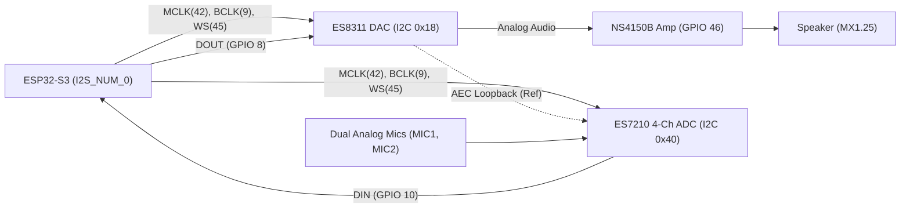

# Audio Subsystem Guide (`audio.md`)

Guide to speaker playback, dual-microphone capture, hardware Acoustic Echo Cancellation (AEC), and voice AI pipelines on the Waveshare ESP32-S3-Touch-AMOLED-1.75 / 1.75C.

---

## 1. Audio Hardware Architecture

The board features a full-duplex voice-AI audio front-end on a **single shared I²S bus (`I2S_NUM_0`)**:

### Pin & Address Summary
* **I²C Control Bus**: `SDA = GPIO 15`, `SCL = GPIO 14`
  * **ES8311** (Mono Audio DAC): **`0x18`**
  * **ES7210** (4-Ch Audio ADC): **`0x40`**
* **I²S Digital Audio Bus**:
  * `MCLK`: **GPIO 16 on `-1.75C`** / **GPIO 42 on `-1.75`** (`256 × sample_rate`, e.g., `4.096 MHz` for `16 kHz` — **critical: using `GPIO 42` on `-1.75C` leaves `ES8311` with no master clock and produces silence!**)
  * `BCLK` (SCLK): **GPIO 9**
  * `LRCK` (WS): **GPIO 45**
  * `DOUT` (ESP32 $\rightarrow$ ES8311 DAC): **GPIO 8**
  * `DIN` (ES7210 ADC $\rightarrow$ ESP32): **GPIO 10**
* **Power Amplifier Enable (`PA_CTRL`)**: **GPIO 46** (Controls **NS4150B** Class-D amplifier; `High` = Unmute/On, `Low` = Mute/Shutdown).

---

## 2. Full-Duplex Shared I²S Bus Rules

Because `ES8311` (speaker) and `ES7210` (microphones) share `MCLK (42)`, `BCLK (9)`, and `WS (45)`:
1. **Configure One Full-Duplex I²S Channel**: Always initialize `I2S_NUM_0` with **both** `tx_chan` and `rx_chan` using the **same sample rate** (e.g., `16000 Hz`, 16-bit) when using speaker and mics simultaneously.
2. **Keep `MCLK` Running**: Both ES8311 and ES7210 derive their internal delta-sigma clocks from `MCLK` (`GPIO 42`). Initialize and enable the I²S peripheral **before** configuring ES8311/ES7210 registers over I²C so `MCLK` is active during codec calibration.
3. **Use `esp_codec_dev` / Official BSP**: The Waveshare BSP (`bsp_audio_codec_speaker_init()` and `bsp_audio_codec_microphone_init()`) wraps `espressif/esp_codec_dev` to manage both codecs seamlessly.

---

## 3. Acoustic Echo Cancellation (AEC) & Dual-Mic Array

The **ES7210** is a 4-channel ADC wired specifically for Espressif's **ESP-SR (Speech Recognition / AFE)** pipeline:
* **Channel 1 (`MIC1`)**: Left/Primary Onboard Microphone
* **Channel 2 (`MIC2`)**: Right/Secondary Onboard Microphone
* **Channel 3 (`AEC Reference`)**: Hardware analog loopback from the speaker output (`ES8311`)
* **Channel 4**: Unused / Grounded

### ESP-SR `afe_config` Input Format
When configuring Espressif's Audio Front-End (`esp_afe_sr_iface_t`):
* When using TDM or multi-channel capture from the ES7210, the channel ordering string for `afe_config_init()` is typically **`"MMNR"`** or **`"MMR"`** (`M` = Microphone, `R` = Reference playback loopback, `N` = Unused channel) depending on whether TDM 4-slot or standard 2-ch stereo mode is enabled in the ES7210 driver.
* This hardware loopback allows the board to hear your voice ("Wake word" / interruption) even while the speaker is actively talking or playing music!

---

## 4. Pop-Free Startup & Power Saving (`PA_CTRL` / `GPIO 46`)

1. **Avoid Speaker Pop on Boot/Wake**:
   * Keep `GPIO 46` (`PA_CTRL`) **LOW** while initializing the I²S bus and `ES8311` DAC.
   * Start the I²S clock and write a buffer of zeros (silence).
   * Only pull `GPIO 46` **HIGH** *after* the ES8311 DAC output has stabilized.
   * Before stopping I²S or entering sleep, pull `GPIO 46` **LOW** first, wait `10 ms`, then power down the ES8311.
2. **Idle Power Draw**:
   * Leaving the NS4150B amplifier enabled (`GPIO 46 = HIGH`) while no audio is playing wastes $\sim 3\text{–}5\text{ mA}$ of quiescent current and can produce faint hiss if DAC gain is maxed. Always set `GPIO 46 = LOW` when audio playback finishes.
3. **Strapping Pin Note (`GPIO 45` & `GPIO 46`)**:
   * `GPIO 45` (`VDD_SPI` voltage selector) and `GPIO 46` (ROM log printing / boot mode) are ESP32-S3 strapping pins with internal/board pull-downs. Because they are purely used as outputs driven by the ESP32-S3 after boot (`I2S_WS` and `PA_CTRL`), they work safely out of the box—just never wire an external pull-up resistor to them.
5. **Streaming Flash-Mapped Audio via `esp_codec_dev` (`ES8311`)**:
   * Ensure `AXP2101` peripheral 3.3V LDO rails (`ALDO1`–`ALDO4`, `BLDO1`, `DLDO1`) are enabled before initializing `ES8311` (`0x18`) so its analog `AVDD` rail is powered.
   * Open `I2S` and `esp_codec_dev_open()` in **16-bit Stereo (`channel = 2`, `I2S_SLOT_MODE_STEREO`)** and stream mono flash-mapped PCM samples through a small writable internal-SRAM stereo buffer (`L = R = sample`) rather than passing read-only `DROM` flash pointers directly to `esp_codec_dev_write()` (see [main/hal_board.cpp](main/hal_board.cpp) and [lessons.md](lessons.md)).
